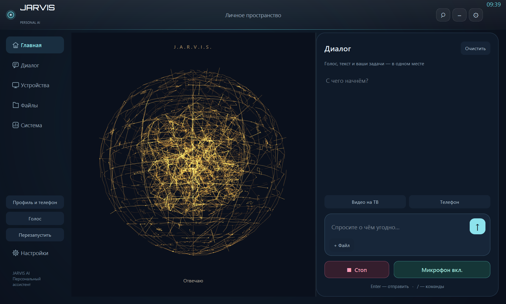
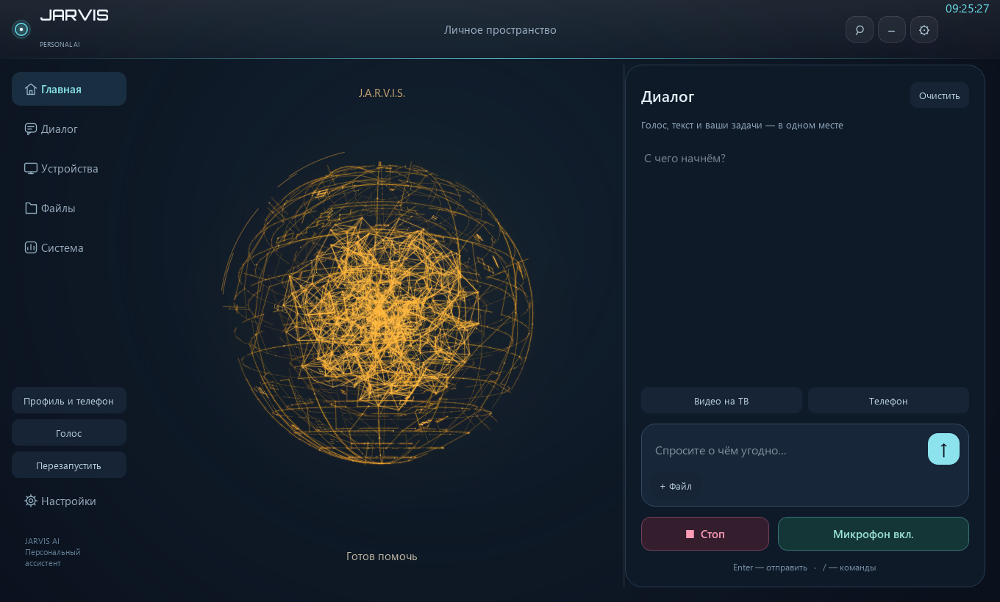
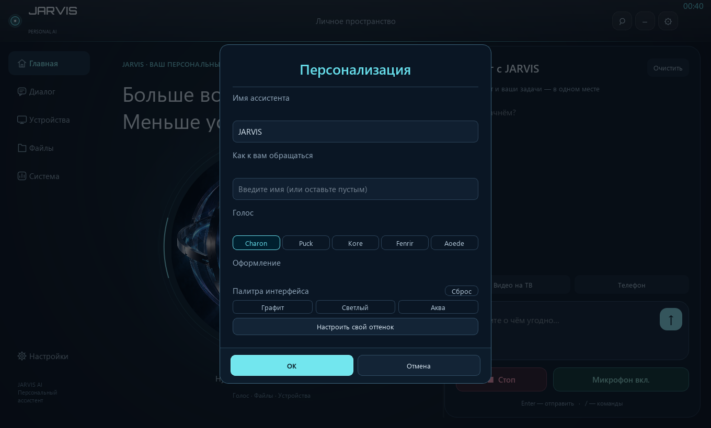
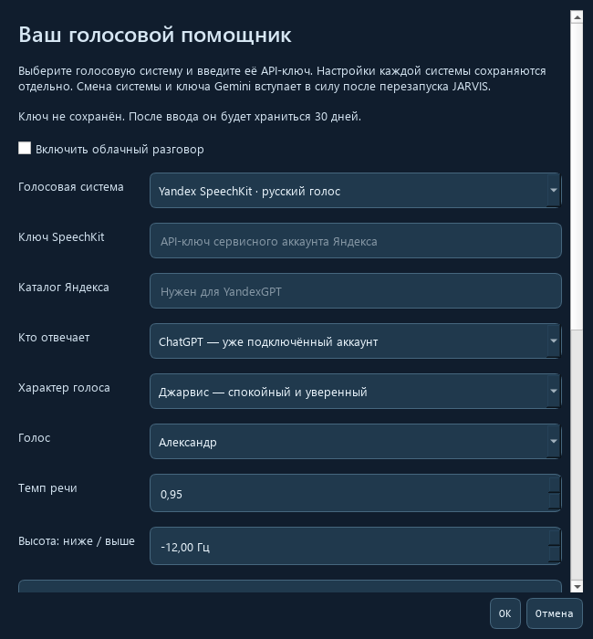

# JARVIS 2.2.0 — screenshots

These screenshots show the Windows desktop build JARVIS 2.2.0. The source snapshot currently published in this repository does not yet contain this desktop UI, so these images document the separate 2.2.0 build rather than the current repository source tree.

## Main workspace

The desktop workspace shows the amber study core, dialog panel, and separate Stop and Microphone controls.

## Study profile

## Personalization

## Cloud voice settings

The API key fields are empty. Do not publish screenshots that contain real credentials or personal data.
